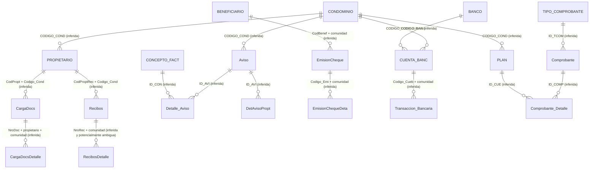
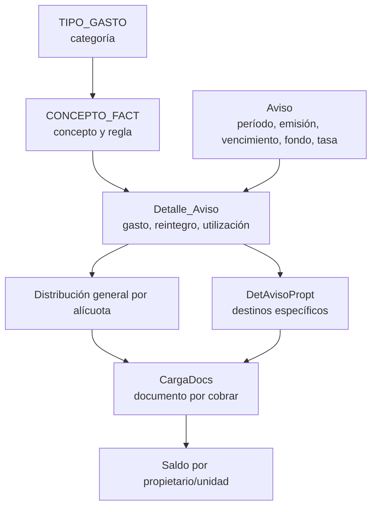
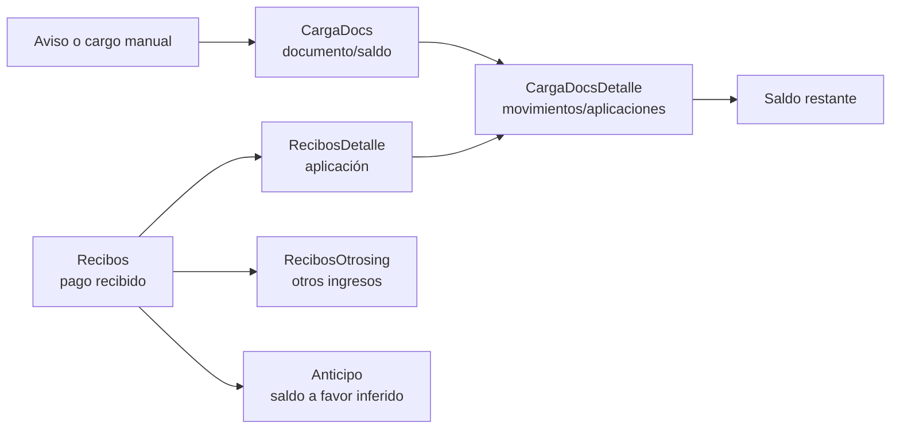
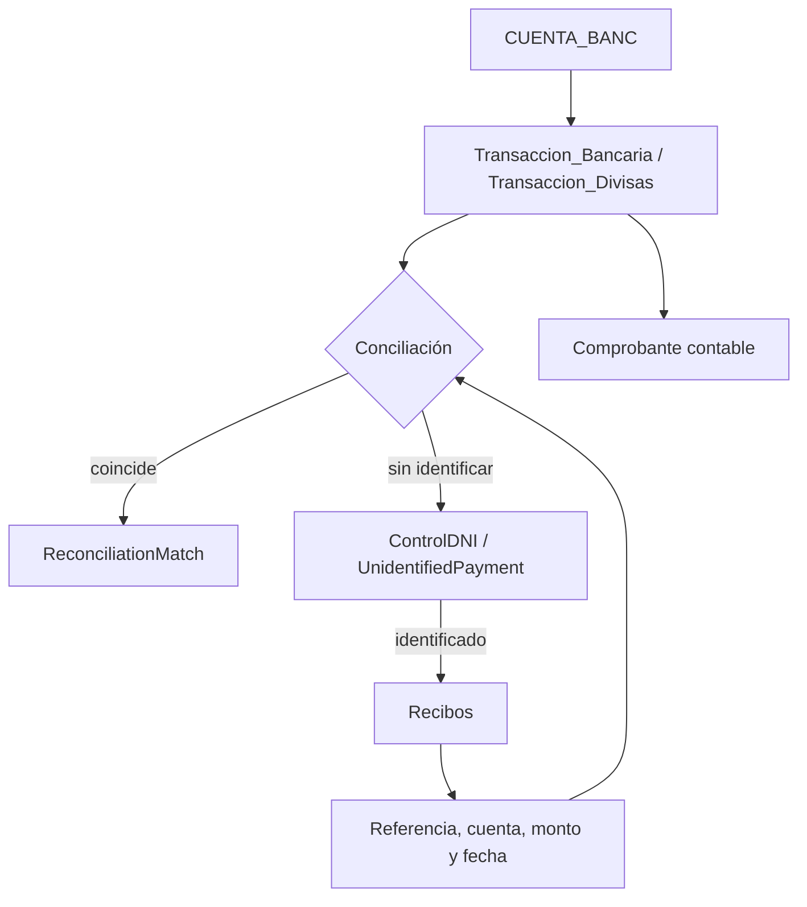
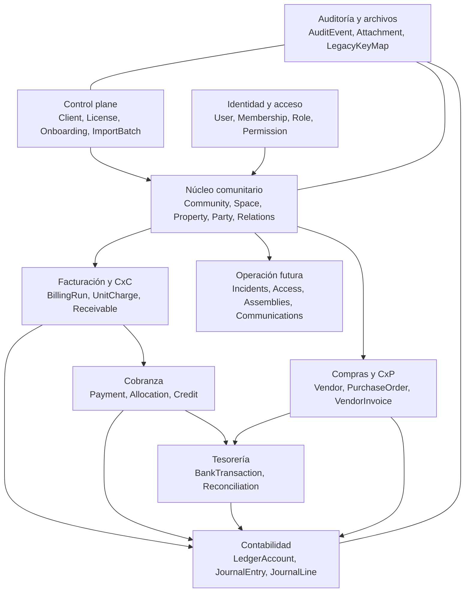
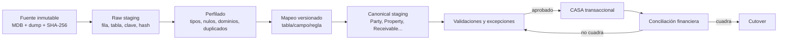

# Auditoría del sistema legacy y arquitectura objetivo de CASA

## 1. Alcance y método

Esta auditoría se realizó sobre `dump.sql`, exportado automáticamente desde
`BDCondominioCaribbean.mdb` mediante **MS Access to MySQL (Bullzip)**. El dump
no representa un modelo MySQL diseñado de origen: conserva decisiones,
limitaciones y artefactos de Microsoft Access.

Se aplicaron cuatro niveles de análisis:

1. **DDL:** tablas, columnas, tipos, obligatoriedad, claves e índices.
2. **Datos:** volúmenes, muestras enmascaradas, cardinalidades, huérfanos,
   duplicados, rangos de fecha y saldos.
3. **Negocio:** reconstrucción de facturación, cobranza, tesorería,
   conciliación, egresos y contabilidad.
4. **Destino:** contraste con el núcleo actual de CASA y diseño de la
   migración.

Convenciones utilizadas:

- **Confirmado:** existe evidencia directa en DDL o registros.
- **Inferencia:** conclusión respaldada por nombres, valores o cardinalidad,
  pero no por una restricción declarada.
- **Por validar:** requiere confirmar comportamiento en el sistema original o
  con Luis Venezuela.

Los datos sensibles de las muestras fueron enmascarados. Las contraseñas del
sistema antiguo no deben copiarse a CASA.

## 2. Resumen ejecutivo

### 2.1 Hechos confirmados

- El dump contiene **120 tablas**, **1.747 columnas** y **316.645 registros**.
- Existen **0 claves foráneas declaradas**, **0 vistas**, **0 triggers**, **0
  procedimientos** y **0 funciones**.
- **76 tablas** no tienen clave primaria declarada.
- **29 tablas** están vacías.
- La base combina tablas maestras, transacciones, copias `_OLD`, resultados de
  reportes `Imp*`, áreas `Temp*` y 34 tablas `EmiTemp_*`.
- El sistema sí contiene núcleos funcionales de cuentas por cobrar, recibos,
  bancos, conciliación, egresos, plan contable, asientos y auditoría.
- `PROPIETARIO` mezcla en una sola fila el inmueble, una persona o razón social,
  contactos y dos alícuotas. No existe una entidad independiente de inmueble,
  persona, copropiedad, residencia o historial de titularidad.
- `CONDOMINIO` mezcla identidad legal, políticas de cobranza, período fiscal,
  contadores, tasa de cambio, rutas de logo y cuentas contables.
- Los importes usan `DOUBLE`; no es un tipo adecuado para un nuevo libro
  financiero.
- Los permisos se almacenan como 88 columnas booleanas en `Perfil_User`.
- `USUARIO.CLAVE` contiene credenciales legacy reversibles. Debe considerarse
  una exposición de seguridad.
- Las relaciones existen principalmente por códigos concatenados o columnas
  homónimas, no por integridad referencial.
- Hay 10 movimientos de cuentas por cobrar y 32 detalles de recibo sin padre.
- 1.176 partidas usan 59 cuentas ausentes del plan vigente, aunque todas
  aparecen en `PLAN_old`.
- `Libro_Mayor` contiene 7.281 filas de 12 códigos de condominio ajenos al
  maestro actual; es una tabla contaminada/reutilizada y no una fuente canónica.
- La estructura `001` reproduce 600 apartamentos, 78 townhouses y 51 locales,
  pero además contiene dos códigos especiales que requieren clasificación.
- `002` contiene 11 cuentas con alícuota cero y evidencia fuerte de ser un
  auxiliar de concesiones, no otro cliente.

### 2.2 Conclusión de arquitectura

CASA no debe copiar esta estructura. Debe importar los hechos económicos y la
historia útiles hacia un modelo canónico multi-condominio, manteniendo además
un archivo inmutable del origen y una tabla de equivalencias de claves.

La migración tiene tres dificultades mayores:

1. **Separar identidades:** una fila de `PROPIETARIO` puede representar una
   unidad, una o varias personas escritas como texto, una empresa o una
   concesión.
2. **Reconstruir el auxiliar por cobrar:** `CargaDocs`, `CargaDocsDetalle`,
   `Recibos` y `RecibosDetalle` deben conciliar hasta reproducir saldos.
3. **Distinguir hechos de resultados temporales:** tablas `Imp*`, `Temp*`,
   `Acumulado`, `Libro_Mayor` y resúmenes no pueden convertirse en una segunda
   fuente de verdad.

## 3. Inventario por familia

| Familia | Tablas representativas | Función | Tratamiento |
|---|---|---|---|
| Comunidad y configuración | `Empresa`, `CONDOMINIO`, `Conjuntos`, `Basededatos` | Identidad y configuración global | Separar identidad, políticas y referencias legacy |
| Inmuebles y titulares | `PROPIETARIO`, `PROPIETARIO_OLD`, `Alicuotas` | Unidad, titular/contacto y alícuota mezclados | Dividir en Party, Property, Ownership y AliquotPeriod |
| Facturación | `Aviso`, `Detalle_Aviso`, `DetAvisoPropt`, `CONCEPTO_FACT`, `TIPO_GASTO` | Avisos y distribución de gastos | Migrar como períodos, corridas, líneas y cargos por inmueble |
| Cuentas por cobrar | `CargaDocs`, `CargaDocsDetalle`, `CargaDocsORI`, `Doc_De_Cobro` | Documentos, saldos y aplicaciones | Migrar y conciliar movimiento por movimiento |
| Cobranza | `Recibos`, `RecibosDetalle`, `RecibosOtrosing`, `InteresesMora` | Pagos, aplicaciones, otros ingresos y mora | Separar pago, recibo, aplicación, crédito e interés |
| Tesorería | `BANCO`, `CUENTA_BANC`, `Transaccion_Bancaria`, `Transaccion_Divisas`, `ControlDNI` | Cuentas, movimientos, conciliación y depósitos no identificados | Migrar a libro bancario y sesiones de conciliación |
| Egresos y proveedores | `BENEFICIARIO`, `EmisionCheque`, `EmisionChequeDeta`, `Factura` | Beneficiarios, pagos y gastos | Separar proveedor, factura, egreso y aplicación contable |
| Contabilidad | `PLAN`, `Comprobante`, `Comprobante_Detalle`, `TIPO_COMPROBANTE` | Plan contable y diario | Migrar con controles de partida doble |
| Seguridad | `USUARIO`, `Perfil_User`, `AuditoriaU` | Identidad, permisos y bitácora | Migrar identidad; reemplazar credenciales y RBAC |
| Copias históricas | `*_OLD`, `CargaDocsORI`, `TIPO_GASTO_ORIGINAL` | Estados anteriores no versionados | Conservar y reconciliar; nunca mezclar a ciegas |
| Reportes y staging | `Imp*`, `Temp*`, `TBLR*`, `EmiTemp_*` | Resultados de consultas, impresión o trabajo temporal | Archivar; recalcular desde entidades canónicas |

El análisis individual de las 120 tablas y sus 1.747 campos está en
`DICCIONARIO_DATOS_LEGACY.md`.

## 4. Reconstrucción del modelo actual

### 4.1 Mapa conceptual legacy

Ninguna línea del diagrama anterior está protegida por una `FOREIGN KEY` en el
dump. Cada relación debe validarse antes de importar.

### 4.2 Comunidad, unidades y propietarios

**Confirmado:** `PROPIETARIO` tiene como clave `ID_PRO`, construida a partir de
un código de cuatro caracteres y el código de condominio. La misma fila contiene
`APTO`, `REPRESENTANTE`, `CEDULA`, `ALICUOTAT`, `ALICUOTAC` y contactos.

**Inferencia:** `CODIGO_PRO` se comporta más como identificador de cuenta o
unidad que como identificador global de persona. El campo `REPRESENTANTE` puede
contener una persona, varios nombres concatenados o una razón social.

Consecuencias:

- no se pueden identificar copropietarios individualmente;
- un cambio de dueño sobreescribe el maestro o depende de `_OLD`;
- no hay historial de porcentajes de propiedad;
- propietario, representante, inmueble y cuenta por cobrar son conceptos
  indistinguibles;
- edificio/torre se codifica dentro de `APTO`, no como estructura;
- una misma persona en dos comunidades no puede reconocerse con seguridad.

### 4.3 Aviso de cobro y distribución

Flujo probable:

**Inferencia:** `APL_CUOT`, `APL_RES`, `AplicaT` y `AplicaP` controlan si un
concepto participa en cuota, resumen, totalidad o propietarios específicos.
Su semántica exacta requiere probar casos en la aplicación original.

El aviso legacy conserva el total comunitario, pero la obligación individual
parece materializarse en `CargaDocs`. CASA deberá conservar ambos niveles:

- costo y reintegro de la comunidad;
- regla de distribución;
- cargo exacto resultante para cada inmueble;
- tasa de cambio congelada;
- fondo, provisión, cuota especial o crédito identificado por tipo.

### 4.4 Cuentas por cobrar y cobranza

`CargaDocs` es el candidato principal al auxiliar histórico. `CargaDocsORI`
parece una fotografía original y no debe sumarse a `CargaDocs`; debe utilizarse
para conciliación.

En CASA:

- el **pago** representa dinero recibido;
- el **recibo** es el documento emitido;
- la **aplicación** indica qué deuda se canceló;
- el **anticipo** es crédito disponible que surge del excedente y no un método
  configurable;
- el **cruce de cuenta** es una compensación aprobada y auditable;
- un pago puede aplicarse parcialmente a varios cargos;
- un cargo puede recibir varios pagos.

### 4.5 Tesorería y conciliación

El booleano `CONCILIADA` no conserva por sí solo quién concilió, cuándo, contra
qué registro, con qué tolerancia ni si la conciliación se revirtió. CASA debe
modelar sesiones y coincidencias explícitas.

### 4.6 Egresos, proveedores y gastos

`BENEFICIARIO` funciona como payee/proveedor. `EmisionCheque` registra la orden
o egreso y `EmisionChequeDeta` distribuye el monto entre conceptos. El nombre
“cheque” ya no describe todos los medios: los registros incluyen cuentas,
efectivo y transferencias.

La tabla `Factura` está vacía. Por tanto, **no hay evidencia suficiente** de un
ciclo formal de cuentas por pagar con factura, aprobación, vencimiento, orden
de compra y recepción. CASA debe implementarlo como dominio separado:

### 4.7 Contabilidad

`PLAN` es el plan de cuentas; `Comprobante` y `Comprobante_Detalle` son cabecera
y partidas. `Acumulado`, `Libro_Mayor` y `Balance_Comprobacion` son resultados
o snapshots y no deben constituir otro libro.

CASA deberá exigir:

- partidas en `DECIMAL`, nunca `DOUBLE`;
- suma de débitos igual a suma de créditos por asiento y moneda;
- período contable abierto;
- origen trazable (`payment`, `billing_run`, `expense`, `reconciliation`,
  `manual`);
- reverso, no edición destructiva, después de contabilizar;
- identificador idempotente para no contabilizar dos veces;
- tasa y montos funcional/transaccional congelados en cada partida.

### 4.8 Usuarios, permisos y auditoría

`Perfil_User` materializa cada permiso como una columna. Agregar una función
obliga a alterar la tabla y todas las pantallas. CASA debe usar RBAC con permisos
como filas y alcance por comunidad.

`AuditoriaU` conserva usuario, módulo, proceso, fecha y hora, pero no posee clave,
antes/después estructurado, entidad, IP, sesión ni garantía de inmutabilidad.

**Medida obligatoria:** importar únicamente la identidad útil de los usuarios,
invalidar toda contraseña antigua, emitir invitaciones y exigir contraseña
nueva con hash moderno. El dump debe custodiarse cifrado y con acceso mínimo.

## 5. Problemas y riesgos del sistema legacy

| Hallazgo | Evidencia | Riesgo | Corrección CASA |
|---|---|---|---|
| Sin integridad referencial | 0 FK en 120 tablas | Huérfanos y uniones incorrectas | FK reales, validación previa y `LegacyKeyMap` |
| Tablas sin identidad | 76 sin PK | Duplicados y migración no idempotente | ID estable, hash de fila y clave natural documentada |
| Persona/unidad mezcladas | `PROPIETARIO` | No soporta copropiedad ni historial | Party, Property, Ownership, Occupancy |
| Configuración monolítica | 45 campos en `CONDOMINIO` | Cambios frágiles | Community + BillingPolicy + FiscalPeriod + PostingConfig |
| Dinero en `DOUBLE` | Importes y tasas | Errores binarios de redondeo | `DECIMAL(19,4)`/`DECIMAL(20,8)` según uso |
| Meses como columnas | `01`…`12` y Enero…Diciembre | Esquema rígido y fórmulas duplicadas | filas por período |
| Doble moneda inconsistente | sufijos `Alt`, `D`, `US$`, `MONEDA`, `Tasa` | Ambigüedad de moneda base | Money(currency, amount) + rate snapshot |
| Códigos concatenados | `ID_PRO`, `ID_CUE`, `ID_AVI` | Dependencia de formato y colisiones | UUID/CUID + claves legacy separadas |
| Copias `_OLD` | maestros y egresos duplicados | Doble contabilización | reconciliar y archivar, nunca sumar |
| Tablas de reporte persistidas | `Imp*`, `TBLR*`, `Libro_Mayor` | Resultados obsoletos | vistas/reportes recalculables |
| Staging por tabla física | 34 `EmiTemp_*` | Escala fija y contaminación entre contextos | staging por `batch_id`/`community_id` |
| Borrado ambiguo | `DelReg` nullable y sin regla | Registros borrados pueden migrar como activos | regla explícita, fecha, actor y motivo |
| Permisos horizontales | 88 booleanos | Imposible evolucionar sin DDL | roles, permissions, role_permissions |
| Passwords reversibles | `USUARIO.CLAVE` | Compromiso de cuentas | no migrar; rotación total |
| Auditoría textual | `AuditoriaU.Proceso` | Difícil investigar y verificar | eventos inmutables con before/after |
| Catálogos duplicados | `Doc_De_Cobro`/`TIPO_DOC_CXC`, `Tasas`/`TipoCambio` | Fuente canónica incierta | validar uso real y consolidar |
| Encoding heredado | cadenas con mojibake | Nombres y conceptos corruptos | detectar origen y transcodificar con revisión |

## 6. Arquitectura objetivo de CASA

### 6.1 Principios

1. Un `Client` controla contrato y licencia; una `Community` contiene la
   operación. En el alcance actual la relación es uno a uno.
2. Toda entidad operativa incluye `community_id`; el servidor lo obtiene del
   contexto autenticado, nunca del criterio libre del navegador.
3. Una Party es única como identidad, pero sus relaciones están aisladas por
   comunidad.
4. Hechos financieros contabilizados son inmutables; se corrigen con reversos.
5. Los derivados se recalculan; no compiten con el libro fuente.
6. Toda importación es idempotente, versionada, auditable y conciliable.
7. Los módulos de CASA comparten un núcleo, no bases ni identidades paralelas.

### 6.2 Dominios y entidades

### 6.3 Núcleo comunitario recomendado

| Entidad | Responsabilidad |
|---|---|
| `Client` | Contrato comercial, solvencia y relación con CASA |
| `License` | Vigencia, precio, renovación, gracia y revocación |
| `Community` | Identidad legal y operativa del condominio |
| `CommunityPolicy` | Opciones versionadas de facturación, mora y operación |
| `SpaceNode` | Jerarquía flexible: sector, edificio/torre, centro comercial, piso |
| `Property` | Unidad cobrable: apartamento, townhouse o local |
| `Party` | Sujeto natural o jurídico |
| `NaturalPerson` / `LegalEntity` | Datos propios del tipo de sujeto |
| `Ownership` | Party–Property, porcentaje y vigencia |
| `Occupancy` | Inquilino/residente y vigencia |
| `PropertyDelegation` | Facultades del administrador de un inmueble |
| `Employment` | Relación laboral/profesional con vigencia |
| `BoardAppointment` | Cargo de junta con vigencia e inmueble representado |
| `AdministrationMandate` | Junta, persona o empresa que administra y alcance |
| `ConcessionAgreement` | Concesionario, canon, moneda, vigencia y ubicación |

La regla “integrante activo de junta no puede ser trabajador activo en la misma
comunidad” debe validarse transaccionalmente en el servicio. Propiedad no es
incompatible con ninguno de esos dos roles.

### 6.4 Facturación transparente

| Entidad | Responsabilidad |
|---|---|
| `BillingPeriod` | Mes y estado: abierto, calculado, emitido, cerrado |
| `ExpenseCategory` | Categoría visible del gasto |
| `ChargeConcept` | Concepto y reglas contables/de distribución |
| `CommunityExpense` | Gasto real con proveedor, documento y soporte |
| `BillingRun` | Emisión comunitaria del período |
| `BillingRunLine` | Gasto, fondo, provisión, cuota o ingreso del período |
| `AllocationRule` | Alícuota, monto fijo, selección de inmuebles u otra base |
| `PropertyCharge` | Resultado exacto por inmueble |
| `Receivable` | Obligación abierta que nace del cargo |
| `ReceivableEntry` | Débito/crédito/aplicación/reverso del auxiliar |

Los fondos, provisiones y cuotas especiales son tipos de línea, no columnas
permanentes. Solo aparecen cuando existen. Los ingresos que reducen la cuota
también son líneas explícitas y opcionales.

### 6.5 Pagos, anticipos y cruces

| Entidad | Responsabilidad |
|---|---|
| `Payment` | Dinero reportado/recibido, moneda, referencia y evidencia |
| `PaymentReceipt` | Numeración y documento entregado |
| `PaymentAllocation` | Importe aplicado a una cuenta por cobrar |
| `OwnerCredit` | Saldo a favor no aplicado, incluido el anticipo |
| `AccountOffset` | Cruce de cuenta aprobado, motivo y obligaciones compensadas |
| `PaymentEvidence` | Soporte privado, hash y metadatos |

El anticipo se crea automáticamente cuando `Payment.amount` supera las
aplicaciones. No es `PaymentMethod`. El cruce tampoco es un método de pago.

### 6.6 Tesorería y contabilidad

CASA debe añadir:

- `FinancialInstitution`;
- `BankAccount`;
- `PaymentMethod`;
- `BankStatementImport` y `BankStatementLine`;
- `BankTransaction`;
- `ReconciliationSession` y `ReconciliationMatch`;
- `UnidentifiedPayment`;
- `FiscalPeriod`;
- `LedgerAccount`;
- `JournalEntry`, `JournalLine` y `PostingRule`;
- `ExchangeRate` con fecha, fuente oficial, moneda base/cotizada y precisión.

### 6.7 Cambios requeridos en el esquema CASA actual

El esquema Prisma actual cubre bien cliente/licencia, comunidad, persona,
inmueble, propiedad, empleo, junta, concesiones, banca, incorporación, acceso y
auditoría. Antes de migrar historia financiera necesita:

1. sustituir o ampliar `Person` por `Party` para personas jurídicas;
2. soportar jerarquía de ubicaciones mediante `parentId`;
3. agregar ocupación, delegaciones y mandato de administración;
4. agregar los dominios financieros descritos arriba;
5. versionar políticas y configuración contable;
6. reemplazar `CommunityAccess.scopes` como única fuente por catálogo de
   permisos y asignaciones consultables;
7. añadir `LegacyKeyMap`, `MigrationIssue`, `ReconciliationResult` e
   idempotency keys;
8. cifrar o tokenizar campos bancarios sensibles;
9. decidir precisión monetaria y moneda funcional por comunidad;
10. implementar invariantes de vigencia y exclusión entre junta/empleo.

## 7. Estrategia de migración

### 7.1 Capas

### 7.2 Orden de carga

1. `Client`, `License`, `Community` y políticas.
2. Bancos, cuentas, monedas, tasas y plan contable.
3. `Party`, `Property`, ubicaciones, propiedad y concesiones.
4. Proveedores, conceptos, categorías y tipos documentales.
5. Períodos y avisos de cobro.
6. Documentos y movimientos de cuentas por cobrar.
7. Pagos, recibos, aplicaciones, créditos y cruces.
8. Egresos, facturas verificadas y movimientos bancarios.
9. Asientos y partidas contables.
10. Auditoría legacy y archivo histórico.
11. Conciliaciones de control y activación.

### 7.3 Política por tipo de tabla

- **Migrar como dato canónico:** maestros vigentes y hechos transaccionales.
- **Transformar/dividir:** `CONDOMINIO`, `PROPIETARIO`, `Perfil_User`.
- **Reconciliar, no sumar:** `_OLD`, `CargaDocsORI`, catálogos `ORIGINAL`.
- **Archivar y recalcular:** `Imp*`, `TBLR*`, balances y acumulados.
- **Descartar tras comprobar:** `Temp*`, `EmiTemp_*`, rutas locales.
- **No migrar credenciales:** `USUARIO.CLAVE`.
- **No eliminar el origen:** conservar MDB y dump cifrados, con hash y
  retención definida.

### 7.4 Validaciones de aceptación

La migración no se considera correcta por haber insertado filas. Debe cumplir:

| Control | Criterio |
|---|---|
| Inventario | 100% de tablas clasificadas como migrar, archivar o descartar con motivo |
| Identidades | Cada fila útil de propietario tiene Party/Property o excepción aprobada |
| Alícuotas | Sumas y grupos cuadran con las reglas confirmadas |
| CxC por unidad | Saldo de apertura CASA = saldo legacy al corte |
| CxC global | Débitos − créditos = saldo total por comunidad y moneda |
| Pagos | Total recibido por período/cuenta/moneda coincide |
| Bancos | Saldo contable y partidas conciliadas coinciden al corte |
| Egresos | Total por proveedor/período/moneda coincide |
| Contabilidad | Débitos = créditos por asiento y balance de prueba |
| Avisos | Totales comunitarios y por inmueble reproducibles |
| Seguridad | 0 contraseñas legacy habilitadas; accesos nuevos auditados |
| Huérfanos | 0 críticos; excepciones no críticas documentadas |

### 7.5 Cutover

1. ensayo completo con copia;
2. informe de diferencias y aprobación;
3. congelamiento breve del legacy;
4. extracción incremental desde el último ensayo;
5. carga idempotente;
6. conciliación final firmada;
7. activación de CASA;
8. legacy en modo consulta;
9. plan de reversa limitado y documentado.

No se recomienda operar ambos sistemas escribiendo durante semanas: crea dos
fuentes de verdad. Si se exige convivencia, debe existir un único escritor y un
flujo de replicación controlado.

## 8. Preguntas obligatorias para Luis Venezuela

1. ¿`CONDOMINIO 002` es realmente otra comunidad o un auxiliar interno para
   concesiones de Caribbean?
2. ¿Cuál es el significado exacto de `ALICUOTAT` y `ALICUOTAC`?
3. ¿`REPRESENTANTE` contiene al propietario legal, un contacto o ambos?
4. ¿Cómo se registran copropietarios e inquilinos fuera de esta base, si se
   registran?
5. ¿Qué valores admite `MONEDA` en cada tabla y cuál es la moneda funcional?
6. ¿Cuál es la diferencia entre `MontoALT`, sufijo `D`, `Tasa`,
   `TipoCambio` y `AMontoUS$`?
7. ¿Qué significan `APL_CUOT`, `APL_RES`, `AplicaT`, `AplicaP`, `IND_ACUM`,
   `GeneChq`, `GenRec`, `SumRes`, `Transf`, `Contab` y `GenCierre`?
8. ¿`DelReg=1` siempre significa eliminado y debe excluirse del saldo?
9. ¿Qué almacena `ActReg` y por qué suele estar vacío?
10. ¿Cuándo y por qué se crean las tablas `_OLD` y `ORIGINAL`?
11. ¿Las tablas `Imp*` y `Temp*` se regeneran siempre o alguna alimenta procesos?
12. ¿Cómo se relaciona inequívocamente `RecibosDetalle` con un recibo cuando no
    incluye mes ni año?
13. ¿Qué representa `NroTrans` en `CargaDocsDetalle` y con qué tabla enlaza?
14. ¿Cómo se genera un anticipo y cómo se consume posteriormente?
15. ¿Cómo se registra y aprueba un cruce de cuenta?
16. ¿Qué transacción convierte un aviso en `CargaDocs`?
17. ¿Qué códigos de comprobante (`996`, `997`, `999`, etc.) son automáticos?
18. ¿Puede editarse un comprobante contabilizado o solo reversarse?
19. ¿Qué criterio define una transacción bancaria como conciliada?
20. ¿`ControlDNI` significa depósito no identificado? ¿Cuál es su ciclo?
21. ¿La tabla `Factura` se abandonó o existe otro archivo/módulo de proveedores?
22. ¿Qué período histórico es legalmente necesario conservar en línea?
23. ¿Hay documentos o soportes fuera de la base que deban relacionarse?
24. ¿Cuál es la fecha exacta y el saldo de corte aceptado por contabilidad?
25. ¿Existen otras bases anuales referenciadas por `Basededatos` que aún no se
    incluyeron?

## 9. Decisión recomendada

Antes de desarrollar más pantallas financieras de CASA:

1. cerrar esta fase de descubrimiento con Luis;
2. aprobar el modelo canónico financiero;
3. extender Prisma con staging, claves legacy y los dominios de facturación,
   cobranza, tesorería y contabilidad;
4. ejecutar una migración simulada de Caribbean;
5. exigir conciliación exacta al corte;
6. solo entonces construir flujos operativos sobre datos reales.

El asistente de mapeo manual ya planteado es correcto, pero debe mapear hacia
**entidades canónicas y reglas versionadas**, no directamente desde una tabla
legacy a una tabla final. Una sola fila de `PROPIETARIO`, por ejemplo, puede
producir varias entidades y una excepción humana.
